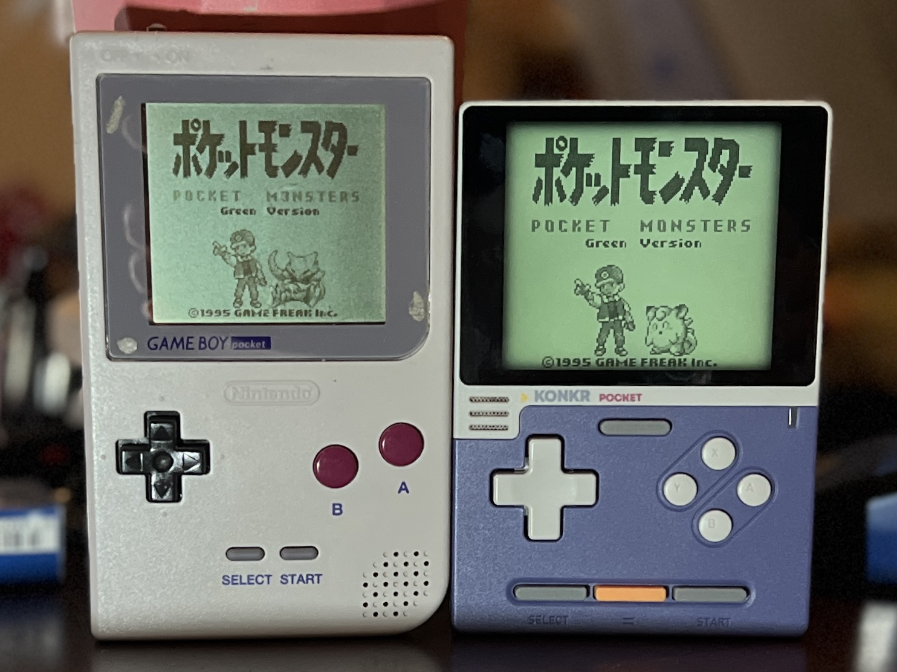
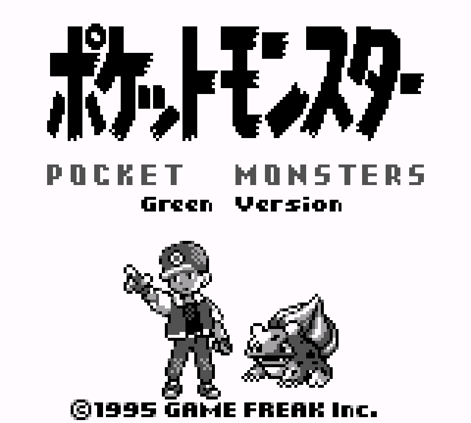
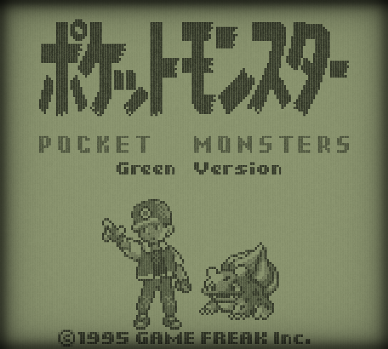
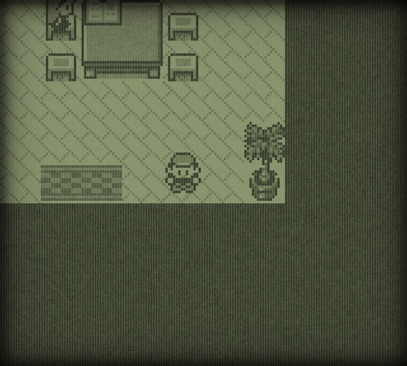
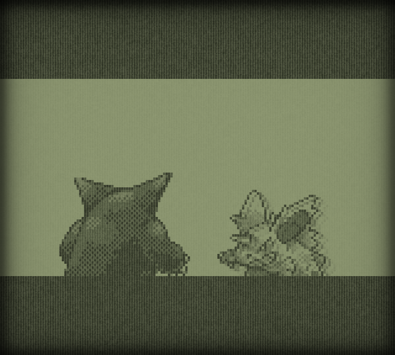

# MGB Native LCD

**English** | [日本語](README_JA.md)

Original MGB hardware (left) and the shader on KONKR Pocket Block (right), photographed together. Lighting and the two displays' brightness affect their apparent colors.

A two-pass RetroArch GLSL shader for the original reflective Game Boy Pocket (MGB) LCD. It models the four-shade cell grid, irregular edges, surface grain, recessed bezel shadow, and short motion persistence. The target is the MGB screen, rather than the DMG palette.

This is a visual model tuned with physical comparisons on KONKR Pocket Block, not a measured reflectance or color profile. Panel brightness, lighting, and color processing affect the result.

**Required: turn on RetroArch Integer Scale** at **Settings → Video → Scaling → Integer Scale**. A shader preset cannot set this RetroArch video option. Fractional scaling makes cell widths uneven and can produce moiré, even when the preset loads successfully.

## Download

Download [MGB Native LCD v0.1.0](https://github.com/game-de-it/mgb-native-lcd/releases/tag/v0.1.0). Choose one of the two shader archives:

| Choose this file | Target | Source directory |
| --- | --- | --- |
| [**MGB-Native-LCD-Standard-v0.1.0.zip**](https://github.com/game-de-it/mgb-native-lcd/releases/download/v0.1.0/MGB-Native-LCD-Standard-v0.1.0.zip) (default) | Pocket Block and other ordinary GL/GLSL RetroArch devices or operating systems | [`shader-only/`](shader-only/) |
| [**MGB-Native-LCD-Pixel2-v0.1.0.zip**](https://github.com/game-de-it/mgb-native-lcd/releases/download/v0.1.0/MGB-Native-LCD-Pixel2-v0.1.0.zip) | plumOS-pixel2 only | [`pixel2/`](pixel2/) |

The standard archive is the normal choice. Use the Pixel2 archive only for the tested plumOS-pixel2 GL/FBO rotation path. Keep the shader files from each archive together; do not mix the final-pass files. Verify downloads with [SHA256SUMS](https://github.com/game-de-it/mgb-native-lcd/releases/download/v0.1.0/SHA256SUMS).

## Visual comparison

These digital RetroArch captures show output before it reaches a physical LCD. They do not capture the MGB's reflected light or viewing angle; the game animation frames may differ.

| Shader OFF | Shader ON |
| --- | --- |
|  |  |

Additional shader-on RetroArch captures show a room scene and the game's intro. The surface texture remains visible in both bright and dark areas:

| Room | Intro |
| --- | --- |
|  |  |

Original MGB photos guided the design. Camera white balance, glare, and uneven lighting prevent direct reflectance measurement from them. The game artwork in these comparison images retains its original rights.

## Display model

### 1. Pixel structure and surface

The cell model starts with `R_s = B_s − A(x,y) Δ_s + G_s(x,y)`: gap-side RGB `B_s`, active-cell coverage `A`, gap-to-face difference `Δ_s`, and surface grain `G_s`. The default active cell is 0.86 source pixels wide and 0.96 high; a fixed coordinate hash perturbs each edge by up to 0.0075 pixels (`MGB_EDGE_VARIATION = 0.015` peak-to-peak). This breaks the perfectly straight grid.

The blank-looking background is the brightest of the four GB shades. Its faint grid uses a dark cell face, brighter gap, and intermediate grain. The three darker shades use stronger neutral grain. One screen-fixed pattern is shared across all four shades.

| Parameter | Default | Purpose |
| --- | ---: | --- |
| `MGB_APERTURE_X` / `MGB_APERTURE_Y` | `0.86` / `0.96` | Active-cell dimensions |
| `MGB_EDGE_VARIATION` | `0.015` | Irregular boundaries |
| `MGB_OFF_GRID` | `0.060` | Faint grid in the brightest shade |
| `MGB_LIGHT_GRAIN_FRACTION` | `0.50` | Bright-shade grain between face and gap |
| `MGB_ROUGHNESS` | `0.100` | Grain in the darker three shades |

These are display RGB tuning values, not measured physical reflectances. See the [optical equations](docs/model-ja.md) and [temporal investigation](docs/ghosting-investigation-ja.md).

### 2. Color response

The 160 × 144 four-shade GB image is mapped to muted reflective LCD colors and multiplied by RGB gains `(0.82, 0.83, 0.71)`. The gains were visually selected from MGB and Pocket Block photos taken under the same light, using a white area for camera white balance. Disable any core or frontend DMG palette or colorization before this shader, or that color will affect its input.

### 3. Bezel shadow

Four continuous edge profiles suggest the MGB LCD's recessed position. Default reach is 8 source cells per edge with strength `0.60`; top is 1.20× and right 0.90× the base strength. The physical depth was not measured from the photos.

### Temporal response

Pass 1 stores per-cell response and a shared motion value in a feedback buffer. Darkening and clearing speeds default to `0.55` and `0.22`. Pass 2 draws screen-fixed grain, reduces only its contrast while scrolling, and restores it after motion with a `0.88` recovery factor. The grain does not move with game art. The persistence was accepted by visual review on Pocket Block, not calibrated to a measured MGB response time.

## Contents

- [`shader-only/`](shader-only/): installable preset, two GLSL passes, and bilingual instructions.
- [`pixel2/`](pixel2/): separate plumOS-pixel2 preset, rotated final pass, and configuration example.
- [`docs/model-ja.md`](docs/model-ja.md): static optical model and equations.
- [`docs/ghosting-investigation-ja.md`](docs/ghosting-investigation-ja.md): temporal design and diagnostics.
- [`docs/parameters.md`](docs/parameters.md) / [`docs/parameters-ja.md`](docs/parameters-ja.md): every RetroArch shader parameter, its range, and its visual effect.
- [`reference/device-profile.md`](reference/device-profile.md) and [`reference/tuning-notes.md`](reference/tuning-notes.md): observed conditions and parameter provenance.
- [`docs/`](docs/): device deployment records.

## Install and test

1. Copy the three shader files from [`shader-only/`](shader-only/) to one RetroArch shader directory without renaming them. The `.glslp` alone is insufficient.
2. Select a GL/OpenGL-compatible RetroArch video driver for the GLSL preset. Restart RetroArch if the driver changed.
3. **Set Settings → Video → Scaling → Integer Scale to ON.** This is required for the intended grid. In a config file it is `video_scale_integer = "true"`. Check core, content, and game overrides for conflicting values.
4. Use a GB core producing a 160 × 144 image with DMG palette/colorization disabled. Load `mgb-grain-fade.glslp` in **Quick Menu → Shaders → Load Preset** and enable shaders.
5. Check the faint grid in a flat bright area and grain in a dark area. If line widths vary or moiré appears, inspect the actual integer-scaled viewport and frontend scaling.

For tuning, see the [shader parameter guide](docs/parameters.md). It also ships inside both ZIPs.

Pocket Block's 800 × 720 output is exact 5× scaling. Other integer scales preserve uniform cell spacing, but fine gaps and grain may look different. The shader cannot force RetroArch's scale or make other panels match its color.

## Compatibility and limitations

The **standard** preset has displayed on Pocket Block, macOS RetroArch GL, plumOS-MF, and ANBERNIC stockOS. On ANBERNIC stockOS, disabling Gambatte's DMG colorization corrected the color; Integer Scale still needs explicit verification there. plumOS-pixel2 uses the [separate Pixel2 package](pixel2/README.md) with a device-specific final-pass rotation and delayed application ([record](docs/pixel2-deployment-ja.md)). The tested plumOS-MMF RetroArch cannot execute GLSL. These observations are not guarantees for other firmware or drivers.

The preset needs feedback-buffer support. A leftover game-specific preset may take precedence over a configuration file's `video_shader`; inspect the active preset after launching a game.

## Release status and license

The shader source and project-authored documentation are released under the [MIT License](LICENSE), © 2026 game-de-it. Game artwork and other third-party image content shown in the comparisons are not licensed by this project.
