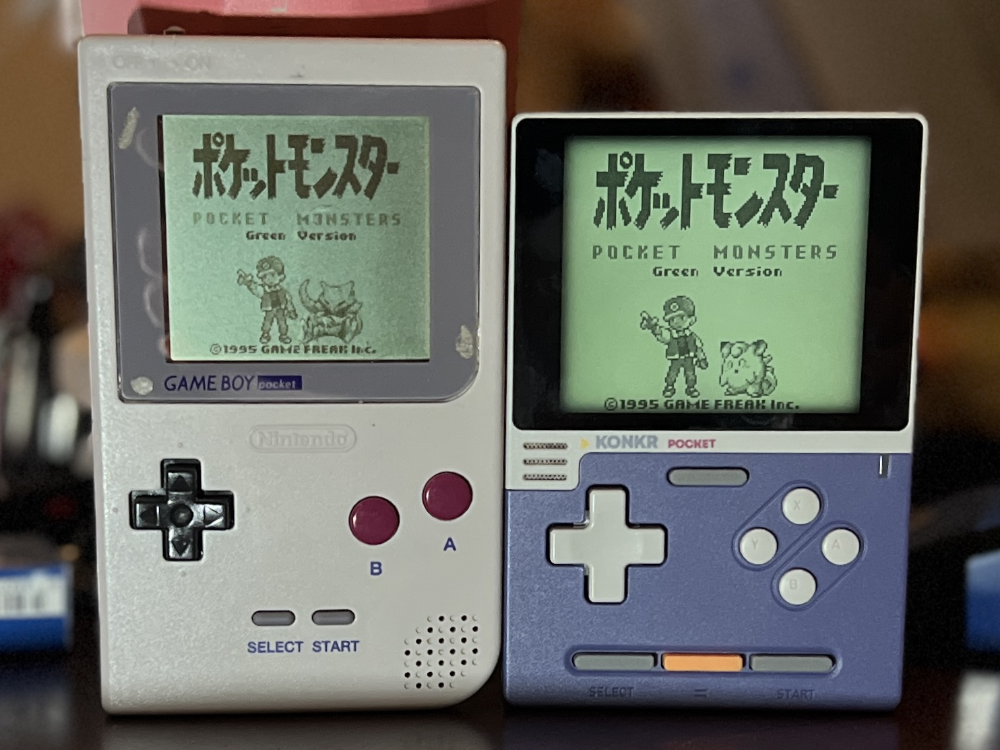
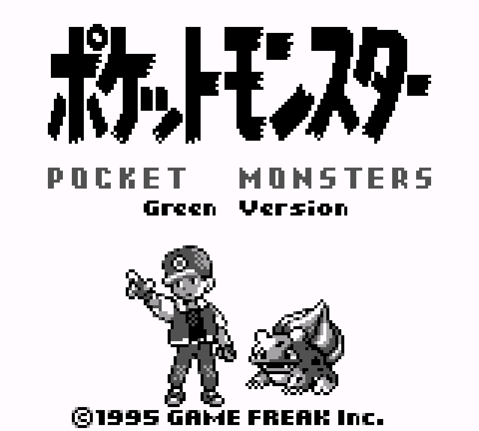
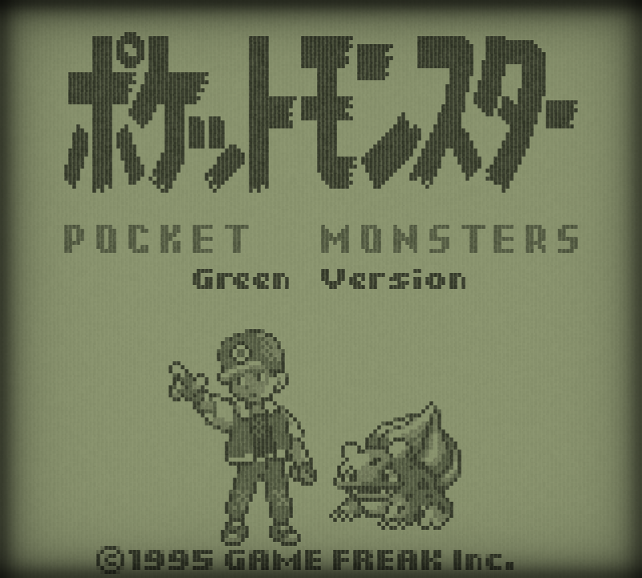
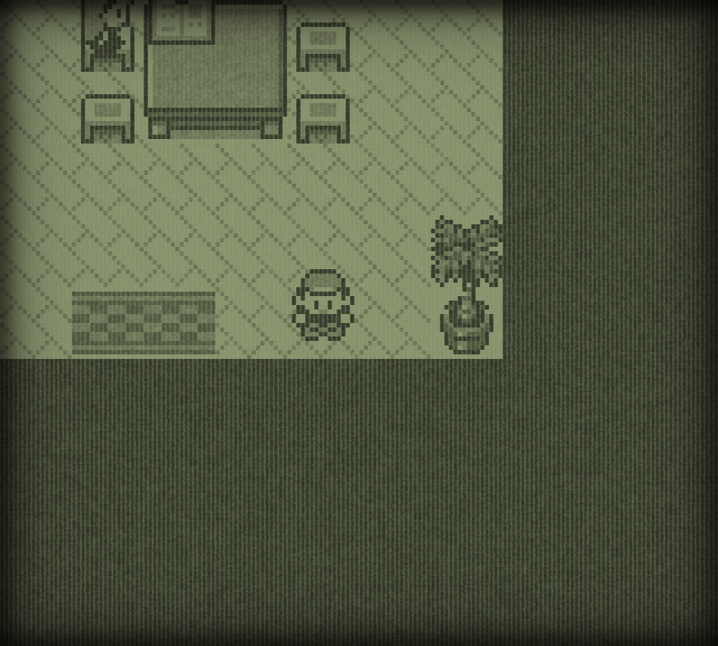
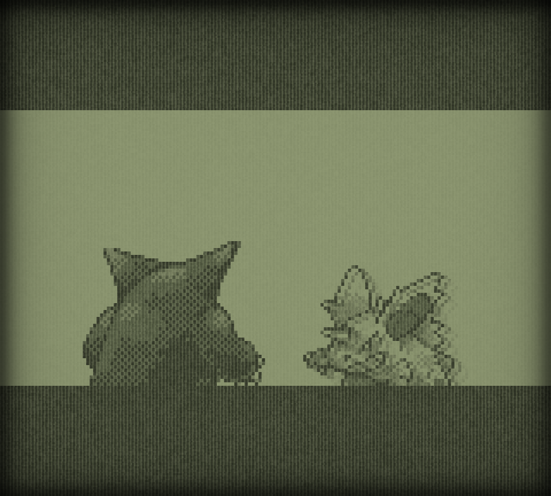

# MGB Native LCD

[English](README.md) | **日本語**

MGB実機（左）とシェーダーを適用したKONKR Pocket Block（右）を同時に撮影した写真です。照明や両画面の輝度によって、見える色は変わります。

ゲームボーイポケット（MGB）の純正反射式液晶を再現するRetroArch用2パスGLSLシェーダーです。4階調のセル格子、歪んだ縁、表面のザラザラ感、ベゼルの影、短い残像を式で表現します。対象はMGBであり、DMGカラーではありません。

実機写真とPocket Block上の表示を比較して調整した視覚モデルです。反射率や分光特性を測定したプロファイルではなく、パネルの輝度・色処理や周囲の照明で見え方が変わります。

**正しい格子表示には、RetroArchの「整数スケール」をONにする必要があります。** 場所は **設定 → ビデオ → スケーリング → 整数スケール** です。シェーダーのプリセットからこのRA側の設定を強制できません。非整数倍率ではセルの幅が不均一になり、モアレが生じることがあります。プリセットの読み込み成功だけでは正しい表示を確認できません。

## ダウンロード

[MGB Native LCD v0.1.0](https://github.com/game-de-it/mgb-native-lcd/releases/tag/v0.1.0)から、次の2種類のシェーダーZIPのどちらかをダウンロードしてください。

| 選ぶファイル | 対象 | 現在の元ファイル |
| --- | --- | --- |
| [**MGB-Native-LCD-Standard-v0.1.0.zip**](https://github.com/game-de-it/mgb-native-lcd/releases/download/v0.1.0/MGB-Native-LCD-Standard-v0.1.0.zip)（通常版・既定） | Pocket Blockや一般的なGL/GLSL対応機種・OS | [`shader-only/`](shader-only/) |
| [**MGB-Native-LCD-Pixel2-v0.1.0.zip**](https://github.com/game-de-it/mgb-native-lcd/releases/download/v0.1.0/MGB-Native-LCD-Pixel2-v0.1.0.zip) | plumOS-pixel2専用 | [`pixel2/`](pixel2/) |

通常はStandard版を選んでください。Pixel2版は確認済みplumOS-pixel2のGL/FBO回転経路だけに使います。2種類の最終パスを混ぜず、それぞれの一式を同じディレクトリへ置いてください。ダウンロード後は[SHA256SUMS](https://github.com/game-de-it/mgb-native-lcd/releases/download/v0.1.0/SHA256SUMS)で照合できます。

## 表示比較

以下は液晶パネルに映る前のRetroArchのデジタルスクリーンショットです。MGBの反射光や視野角は写っておらず、ゲームのアニメーションもフレームが異なる場合があります。

| シェーダーOFF | シェーダーON |
| --- | --- |
|  |  |

シェーダーONで撮った室内とイントロの場面も載せます。明部と暗部の両方で、格子と表面の質感を確認できます。

| 室内 | イントロ |
| --- | --- |
|  |  |

実機MGBの写真はモデルの参考にしましたが、ホワイトバランス、映り込み、照明ムラがあるため、写真のRGB値を反射率として扱っていません。比較画像内のゲーム素材の権利は元の権利者に帰属します。

## 表示モデル

### 1. ドット構造と表面

基礎式は `R_s = B_s − A(x,y) Δ_s + G_s(x,y)` です。`B_s` は隙間側RGB、`A` はセル内部の被覆率、`Δ_s` は隙間とセル面の差、`G_s` は粒状感です。セルの幅は入力画素の0.86、高さは0.96を初期値とし、画面座標に固定したハッシュで縁を最大0.0075画素ほど揺らします（パラメータ `0.015` は揺れ幅全体）。

何も描かれていないように見える背景も4階調のうち最も明るい1色です。この階調ではセル面を暗く、細かい粒を中間、隙間を明るくして薄い格子を残します。暗い3階調にはより強い無彩色の粒を使います。粒の模様と座標は4階調で共通です。

| パラメータ | 初期値 | 役割 |
| --- | ---: | --- |
| `MGB_APERTURE_X` / `MGB_APERTURE_Y` | `0.86` / `0.96` | セル内部の大きさ |
| `MGB_EDGE_VARIATION` | `0.015` | セル縁の不規則さ |
| `MGB_OFF_GRID` | `0.060` | 最明部の薄い格子 |
| `MGB_LIGHT_GRAIN_FRACTION` | `0.50` | 最明部の中間色の粒 |
| `MGB_ROUGHNESS` | `0.100` | 暗い3階調の粒 |

これらは表示RGBの調整値で、実機で測定した反射率ではありません。[静止画モデルの式](docs/model-ja.md)と[残像の試作記録](docs/ghosting-investigation-ja.md)も参照してください。

### 2. 色応答

160×144画素・4階調のGB映像を反射式液晶の控えめな色へ写像し、最後にRGB利得 `(0.82, 0.83, 0.71)` を掛けます。同じ照明下のMGBとPocket Blockの写真で白い領域を基準にし、実機を見ながら決めた値です。GBコアやフロントエンドのDMGパレット・カラー化は解除してください。入力色が変わると、本シェーダーの色処理結果も変わります。

### 3. ベゼルの影

四辺から内側へ連続的に明るくなる影を掛けます。初期値は各辺から入力8画素の広がりと強度 `0.60` で、上辺は1.20倍、右辺は0.90倍です。MGBの液晶がベゼルの奥にある印象を表します。物理的な奥行きの測定値ではありません。

### 時間方向の応答

第1パスはセルごとの応答と画面全体の動き量を履歴に保存します。暗くなる速度は `0.55`、明るく戻る速度は `0.22` です。第2パスは画面に固定した粒を描き、スクロール中だけ粒の濃淡差を弱め、停止後に係数 `0.88` で戻します。粒自体は絵柄に追従しません。残像の強さはPocket Blockで目視確認されましたが、MGBの応答時間を測定したものではありません。

## 内容

- [`shader-only/`](shader-only/)：導入する2パスGLSLプリセットと日英の手順。
- [`pixel2/`](pixel2/)：別配布するplumOS-pixel2専用プリセット、回転版の最終パス、設定例。
- [`docs/model-ja.md`](docs/model-ja.md)：静止画モデルと数式。
- [`docs/ghosting-investigation-ja.md`](docs/ghosting-investigation-ja.md)：残像の設計と診断結果。
- [`docs/parameters-ja.md`](docs/parameters-ja.md)／[`docs/parameters.md`](docs/parameters.md)：RAで変更できる全パラメーターの範囲と見た目への影響。
- [`reference/device-profile.md`](reference/device-profile.md)・[`reference/tuning-notes.md`](reference/tuning-notes.md)：確認環境と数値の根拠。
- [`docs/`](docs/)：端末別の配備記録。

## 導入と確認

1. [`shader-only/`](shader-only/) の3ファイルを、名前を変えず同じRAシェーダーディレクトリへコピーします。`.glslp` だけでは動きません。
2. GLSLプリセットに対応するGL/OpenGL系の映像ドライバーを選びます。変更した場合はRAを再起動します。
3. **設定 → ビデオ → スケーリング → 整数スケールをONにします。** 意図した格子表示の必須条件です。設定ファイルでは `video_scale_integer = "true"`。コア別・コンテンツ別・ゲーム別の上書きでOFFになっていないか確認してください。
4. 160×144のGB映像を出すコアを使い、DMGパレットやカラー化をOFFにします。**クイックメニュー → シェーダー → プリセットを読み込む**から `mgb-grain-fade.glslp` を選び、シェーダーをONにします。
5. 明るい無地部分の薄い格子と暗部の粒を確認します。線幅のばらつきやモアレがあれば、表示領域の倍率とFE側の拡大処理も確認してください。

調整するときは[パラメーター解説](docs/parameters-ja.md)を参照してください。両方のZIPにも収録しています。

Pocket Blockの800×720表示は160×144の正確な5倍です。他の整数倍率でも格子の間隔は均一にできますが、細い隙間や粒の見え方は変わります。シェーダー自体はRAの倍率を強制できず、別パネルで同じ色になることも保証しません。

## 互換性と制限

**通常版**はPocket Block、macOS版RetroArchのGL、plumOS-MF、ANBERNIC stockOSで表示を確認しています。ANBERNIC stockOSではGambatteのDMGカラー化を解除して色を修正しましたが、整数スケールONは別途確認が必要です。plumOS-pixel2では[別配布のPixel2版](pixel2/README_JA.md)を使い、最終パスの回転と適用遅延が必要でした（[配備記録](docs/pixel2-deployment-ja.md)）。確認したplumOS-MMFのRAはGLSLを実行できません。これらは対象環境での観察結果で、全ファームウェアでの動作保証ではありません。

フィードバックバッファへの対応が必要です。古いゲーム別プリセットが残っていると設定ファイルの `video_shader` より優先される場合があります。ゲーム起動後に有効なプリセットを確認してください。

## 公開状況とライセンス

シェーダーのソースと本プロジェクトで作成した文書は[MITライセンス](LICENSE)、© 2026 game-de-itです。比較画像内のゲーム素材など第三者の画像内容には、このライセンスは適用されません。
