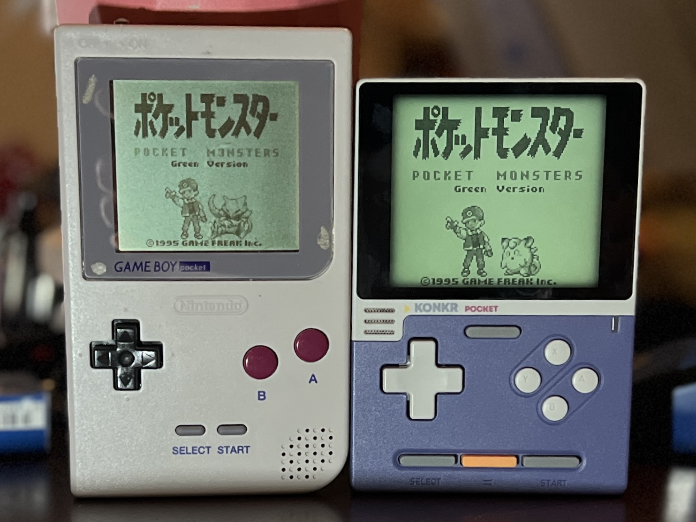

# MGB Native LCD v0.1.0

[English](#english) | [日本語](#日本語)

## English

The first release recreates the original reflective Game Boy Pocket (MGB) LCD as a two-pass RetroArch GLSL shader. Its model combines a slightly irregular cell grid, shade-dependent surface grain, muted reflective color, a recessed bezel shadow, and short temporal response. The grain stays fixed to screen coordinates and becomes less visible during scrolling.

### Visual comparison

The original MGB is on the left; MGB Native LCD on KONKR Pocket Block is on the right. Both were photographed together. Lighting, camera processing, and the two screens' brightness affect their apparent colors. More RetroArch captures and model details are in the [English README](https://github.com/game-de-it/mgb-native-lcd#readme).

### Downloads

- **[MGB-Native-LCD-Standard-v0.1.0.zip](https://github.com/game-de-it/mgb-native-lcd/releases/download/v0.1.0/MGB-Native-LCD-Standard-v0.1.0.zip)** — default for Pocket Block and other ordinary GL/GLSL RetroArch devices and operating systems.
- **[MGB-Native-LCD-Pixel2-v0.1.0.zip](https://github.com/game-de-it/mgb-native-lcd/releases/download/v0.1.0/MGB-Native-LCD-Pixel2-v0.1.0.zip)** — plumOS-pixel2 only. Its final pass includes the tested rotation workaround and a GB-only settings example for delayed application.
- **[SHA256SUMS](https://github.com/game-de-it/mgb-native-lcd/releases/download/v0.1.0/SHA256SUMS)** — checksums for both ZIP files.

Each ZIP includes the GLSL preset and both required passes, MIT license, bilingual installation instructions, and an English/Japanese [guide to all 16 shader parameters](https://github.com/game-de-it/mgb-native-lcd/blob/v0.1.0/docs/parameters.md).

### Install

1. Extract **one** ZIP and keep its preset and `.glsl` files together. Use Standard unless you have the tested plumOS-pixel2 GL/FBO setup.
2. Choose a RetroArch GL/OpenGL-compatible video driver, a 160 × 144 four-shade GB image, and disable the core's DMG palette/colorization.
3. **Turn on Settings → Video → Scaling → Integer Scale.** This is required for an even cell grid; the shader cannot set it for you. In a config file, use `video_scale_integer = "true"`.
4. Load the package's `.glslp` from **Quick Menu → Shaders → Load Preset**. Pixel2 also needs the GB-specific `video_shader_delay = "2"` setting to avoid the startup black screen observed on that device. The included example explains the tested GB override.

### Scope and verification

The Standard shader's appearance and scrolling texture were reviewed on Pocket Block. The unmodified preset also displayed on macOS RetroArch GL and plumOS-MF. ANBERNIC stockOS displayed after Gambatte's DMG colorization was disabled; its Integer Scale setting was not separately verified. Pixel2 displayed upright after a fresh frontend launch with its rotation variant, delayed application, and Integer Scale ON. The tested plumOS-MMF RetroArch build cannot run GLSL. Other panels may differ in color and fine grain.

The two archive presets use relative paths. Each archive was checked for intact files, both shader references, and a feedback pass. The photo used here has no EXIF/XMP metadata; its pixels and ICC color profile were preserved. This is a visual recreation, not a measured MGB reflectance or response-time profile.

### Integrity and license

| Asset | SHA-256 |
| --- | --- |
| `MGB-Native-LCD-Standard-v0.1.0.zip` | `5168a526de228c91ad61ebecf984cf278d63ac9471915f0045586731db9a46e8` |
| `MGB-Native-LCD-Pixel2-v0.1.0.zip` | `c52ecde757c1b7643049469dd735e17f93ffce9a62b74dc3b73ed6296cc791e5` |

[Project source](https://github.com/game-de-it/mgb-native-lcd) · Shader source and project-authored documentation: [MIT License](https://github.com/game-de-it/mgb-native-lcd/blob/v0.1.0/LICENSE). Game artwork shown for comparison retains its original rights.

---

## 日本語

初回リリースでは、ゲームボーイポケット（MGB）の純正反射式液晶をRetroArch用の2パスGLSLシェーダーで再現します。わずかに歪んだセル格子、階調別のザラザラ感、控えめな反射色、ベゼルの影、短い残像を組み合わせました。粒の模様は画面座標に固定され、スクロール中は一時的に視認性が下がります。

### 表示比較

左がMGB実機、右がKONKR Pocket Block上のMGB Native LCDです。同時に撮影しましたが、照明、カメラ処理、両画面の輝度によって見える色は変わります。ほかのRAスクリーンショットと数式の説明は[日本語README](https://github.com/game-de-it/mgb-native-lcd/blob/v0.1.0/README_JA.md)にあります。

### ダウンロード

- **[MGB-Native-LCD-Standard-v0.1.0.zip](https://github.com/game-de-it/mgb-native-lcd/releases/download/v0.1.0/MGB-Native-LCD-Standard-v0.1.0.zip)** — 通常版・既定。Pocket Blockと一般的なGL/GLSL対応機種・OS向け。
- **[MGB-Native-LCD-Pixel2-v0.1.0.zip](https://github.com/game-de-it/mgb-native-lcd/releases/download/v0.1.0/MGB-Native-LCD-Pixel2-v0.1.0.zip)** — plumOS-pixel2専用。実機で確認した最終パスの回転処理と、GB専用の適用遅延設定例を含みます。
- **[SHA256SUMS](https://github.com/game-de-it/mgb-native-lcd/releases/download/v0.1.0/SHA256SUMS)** — 2つのZIPのチェックサム。

各ZIPにはプリセット、必要な2つのGLSLファイル、MITライセンス、日英の導入説明、[16項目のパラメーター解説](https://github.com/game-de-it/mgb-native-lcd/blob/v0.1.0/docs/parameters-ja.md)を収録しています。

### 導入方法

1. **どちらか一方**のZIPを展開し、プリセットと`.glsl`を同じ場所に置きます。確認済みplumOS-pixel2のGL/FBO環境以外ではStandard版を選んでください。
2. RetroArchのGL/OpenGL系映像ドライバー、160×144・4階調のGB映像を使い、コアのDMGパレット・カラー化を解除します。
3. **設定 → ビデオ → スケーリング → 整数スケールをONにします。** 格子の線幅を均一にする必須条件です。シェーダーからは設定できません。設定ファイルのキーは `video_scale_integer = "true"` です。
4. **クイックメニュー → シェーダー → プリセットを読み込む**から同梱の`.glslp`を選びます。Pixel2では、起動時の黒画面を防ぐためGB専用に `video_shader_delay = "2"` も必要です。設定例を同梱しています。

### 対象環境と検証

Standard版はPocket Blockで静止画の見え方とスクロール中の粒を確認しました。元のプリセットはmacOS版RetroArchのGLとplumOS-MFでも表示されました。ANBERNIC stockOSではGambatteのDMGカラー化を解除すると表示できましたが、整数スケールONは個別に未確認です。Pixel2では専用回転版、適用遅延、整数スケールONにより、FEからの再起動時にも正立表示を確認しました。確認したplumOS-MMFのRAはGLSLに対応していません。別のパネルでは色や細かい粒が変わる場合があります。

両ZIPのプリセットは相対パスです。ファイルの完全性、2つのシェーダー参照、フィードバックパスを確認しました。掲載写真のEXIF/XMPは除去済みで、画素とICC色プロファイルは保持しています。これは視覚的な再現で、MGBの反射率や応答時間を実測したプロファイルではありません。

### チェックサムとライセンス

| ファイル | SHA-256 |
| --- | --- |
| `MGB-Native-LCD-Standard-v0.1.0.zip` | `5168a526de228c91ad61ebecf984cf278d63ac9471915f0045586731db9a46e8` |
| `MGB-Native-LCD-Pixel2-v0.1.0.zip` | `c52ecde757c1b7643049469dd735e17f93ffce9a62b74dc3b73ed6296cc791e5` |

[ソースコード](https://github.com/game-de-it/mgb-native-lcd) · シェーダーのソースと本プロジェクトで作成した文書：[MITライセンス](https://github.com/game-de-it/mgb-native-lcd/blob/v0.1.0/LICENSE)。比較画像内のゲーム素材の権利は元の権利者に帰属します。
